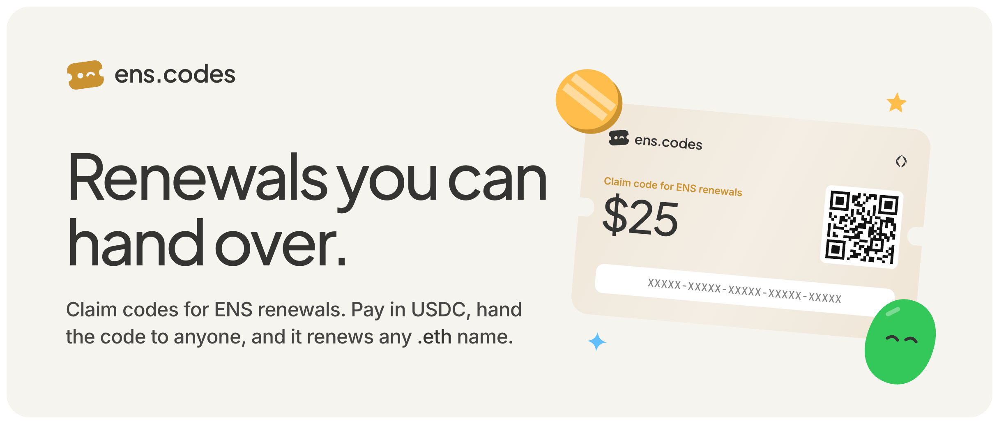
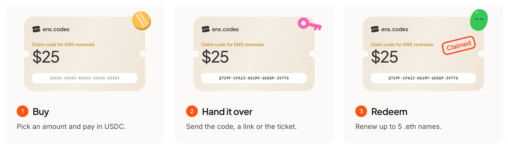
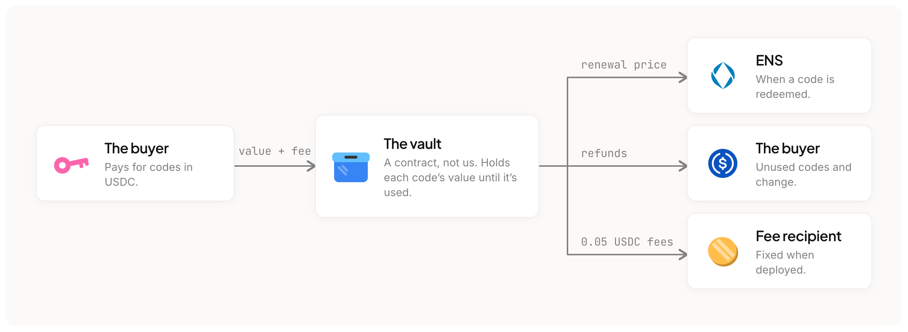
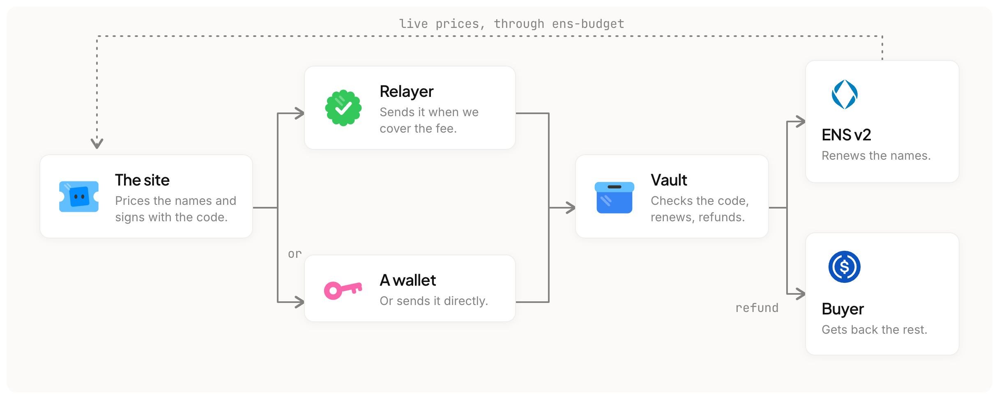

<a href="https://ens.codes">
  <picture>
    <source media="(prefers-color-scheme: dark)" srcset=".github/readme/banner-dark.png">
    
  </picture>
</a>

<p align="center">
  <a href="https://ens.codes"><b>ens.codes</b></a>
  &nbsp;·&nbsp;
  <a href="#how-it-works">How it works</a>
  &nbsp;·&nbsp;
  <a href="#architecture">Architecture</a>
  &nbsp;·&nbsp;
  <a href="#run-it-locally">Run it locally</a>
</p>

<p align="center">
  <a href="https://ens.codes"></a>
  
  <a href="https://github.com/foundry-rs/foundry"></a>
  <a href="https://github.com/wildcardlabs/ens-budget"></a>
  <a href="LICENSE"></a>
</p>

<br>

**ens.codes** turns USDC into claim codes for ENS renewals. Buy a code, hand it to anyone, and
they use it to renew any `.eth` name.

> [!NOTE]
> ens.codes is live on the Sepolia testnet ahead of its mainnet launch.

<br>

## How it works

<picture>
  <source media="(prefers-color-scheme: dark)" srcset=".github/readme/journey-dark.png">
  
</picture>

<br>

<table>
  <tr>
    <td width="50%" valign="top">
      <h3>Used once</h3>
      A code renews up to 5 names in one go. Whatever the renewals don't cost goes back to the buyer.
    </td>
    <td width="50%" valign="top">
      <h3>Any .eth name</h3>
      A code renews any <code>.eth</code> name, whoever owns it. The person holding it picks the names.
    </td>
  </tr>
  <tr>
    <td width="50%" valign="top">
      <h3>Codes for a crowd</h3>
      Buy up to 200 codes at once and export them as a spreadsheet, printable vouchers or images.
    </td>
    <td width="50%" valign="top">
      <h3>Who owns a code</h3>
      Holding a code lets you spend it, but its value stays with the buyer until it's used. The buyer can cancel an unused code at any time, and codes don't expire.
    </td>
  </tr>
</table>

> [!NOTE]
> Codes are intended as gifts and are not designed for resale.

<br>

## Where the money sits

<picture>
  <source media="(prefers-color-scheme: dark)" srcset=".github/readme/money-dark.png">
  
</picture>

A code's value sits in an onchain vault, not with us. It can only go to ENS for a renewal or back
to the buyer.

<br>

## Architecture

<picture>
  <source media="(prefers-color-scheme: dark)" srcset=".github/readme/stack-dark.png">
  
</picture>

| Part | Where |
| :-- | :-- |
| **Site**: buy, redeem and manage codes | [`web/`](web) |
| **Vault**: `ClaimCodeVault`, the contract that holds and spends codes | [`contracts/`](contracts) |
| **Relayer**: sends redemptions for people without a wallet | [`api/`](api) |
| **Pricing**: the longest renewal a budget buys | [`ens-budget`](https://github.com/wildcardlabs/ens-budget) |

<br>

## Run it locally

You need [Foundry](https://book.getfoundry.sh/) and Node 22 or later. The local setup forks mainnet,
so it renews real ENS names with test money.

```bash
scripts/local-fork.sh                 # terminal 1: a mainnet fork on :8545
```

```bash
scripts/local-setup.sh                # terminal 2: deploy the vault and write web/.env.local
npm install
cd web && npm install && npm run dev  # http://localhost:5173
```

Pick **Anvil dev wallet (local)** in the wallet menu.

```bash
cd contracts && forge test            # contract tests
npm test                              # relayer tests, from the repository root
```

<br>

## License

[MIT](LICENSE) © 2026 Namepass LLC
